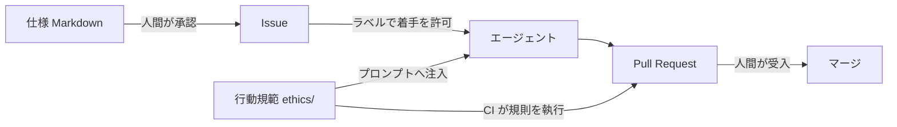

# SDD-template：規範に従う自律エージェントで回す、Issue 駆動の仕様駆動開発

[](https://opensource.org/licenses/MIT)

このリポジトリは、**仕様駆動開発（SDD）を Issue 駆動の自律エージェントで回す**ためのテンプレートです。

人間は仕様を書いて承認し、Issue を切ります。エージェントは Issue を拾って実装し、Pull Request を出します。そのエージェントが従う規範は [`ethics/`](ethics/README.md) に条文として置きます。**`ethics/` に条文を追記すれば、エージェントはその規範に従って動くようになります。**

## 考え方

このテンプレートは、3 つの置き場所を分けます。

| 置き場所 | 答える問い | 更新する主体 |
|---|---|---|
| 仕様（[`docs/specs/`](docs/specs/README.md) の Markdown） | **何を・なぜ** 作るか | 人間（AI は補助） |
| Issue と Pull Request | **どこまで** 進んだか | エージェント |
| 行動規範（`ethics/`） | エージェントは**どう振る舞うべきか** | 人間 |

「意図した動作をさせること」と「規則を守らせること」を別のものとして扱うのが、このテンプレートの中心です。意図は仕様と Issue で伝え、規則は行動規範で縛ります。エージェントは規範を自分では書き換えられません。



## 行動規範：倫理階層

規範は、効力の強さで 4 層に分かれます。上位の層が下位の層を支配し、下位の条文は必ず上位の条文を根拠に持ちます。

| 層 | 答える問い | 改正できる人 | 逸脱 |
|---|---|---|---|
| 理念 | 何のためか | 最高責任者 | 不可 |
| 原則 | どう判断するか | 人間（レビュー必須） | 不可 |
| 規則 | 何をする・しないか | 人間（Pull Request のレビュー） | 例外に明記した場合のみ |
| 慣習 | 普段どうするか | チームの裁量 | 理由を示せば可 |

条文は Markdown で書きます。

```markdown
## R-5 エージェントの Pull Request で規範と執行の仕組みを変更しない

- 強度: MUST NOT
- 根拠: P-7
- 適用点: pr
- 検査: deterministic guards/protected_paths.py
- 違反時: block

エージェントが作る Pull Request に、理念・原則・規則の条文、ガード、…の変更を含めてはならない。
```

規範がエージェントに届く経路は 3 つあります。

| 経路 | 仕組み | 対象 |
|---|---|---|
| プロンプトへの注入 | 条文集を、[`WORKFLOW.md`](WORKFLOW.md)（無人実行のプロンプト）と [`AGENTS.md`](AGENTS.md)（対話で作業するエージェント向けの指示書）へ自動で書き込む | 全条文 |
| Pull Request の自動検査 | CI が、決定的に検査できる規則を Pull Request ごとに実行する | `適用点: pr` かつ `検査: deterministic` の規則 |
| 人間のレビュー | 受入のときに、自動では検査できない条文を確認する | `検査: judge` の条文 |

「絶対に守らせたいこと」は、理念として宣言したうえで、必ず機械的に検査できる規則まで具体化します。理念を書いただけでは守られません。

書式と検査の詳細は [ethics/README.md](ethics/README.md) を参照してください。

### 規範を追加する

1. 該当する層のファイル（`ethics/10-principles/`、`ethics/20-rules/`、`ethics/30-customs/`）に条文を追記し、`根拠` に上位層の条文 ID を書く
2. 機械的に検査できる規則なら、`ethics/guards/` にガードを書く
3. 構造を検査し、エージェントのプロンプトへ反映する

   ```bash
   python3 -m ethics lint ethics --strict --tree
   python3 -m ethics sync
   ```

4. 条文と、`WORKFLOW.md`・`AGENTS.md` の差分を、同じ Pull Request に含める

根拠の欠落などの構造の誤りと、プロンプトへの反映漏れは、CI が検出します。

## Issue 駆動の流れ

工程の進行は、Issue のラベルで表します。タスク 1 件 = Issue 1 件 = Pull Request 1 件です。

| 工程 | ラベル | 動く主体 | 何が起きるか |
|---|---|---|---|
| 仕様の承認待ち | `sdd:backlog` | 人間 | 仕様をレビューし、受入条件を書く |
| 着手可 | `sdd:todo` + `symphony` | 人間が付与 | エージェントが検知する |
| 実装 | `sdd:in-progress` | エージェント | 計画・実装・検証を行い、Pull Request を作る |
| 受入待ち | `sdd:human-review` | 人間 | Pull Request と仕様差分をレビューする |
| 受入完了 | `sdd:merging` | エージェント | マージして Issue を閉じる |
| 差し戻し | `sdd:rework` | エージェント | 新しいブランチでやり直す |

`symphony` ラベルの無い Issue は、エージェントの対象になりません。仕様の承認前に実装が走る事故は、このラベルを人間だけが付ける運用で防ぎます。

運用の詳細は [Issue 駆動開発ガイド](docs/guides/issue-driven-sdd.md) を参照してください。

## はじめかた

1. このリポジトリをフォークし、ローカルにクローンする
2. フォーク先のリポジトリで **Issues を有効にする**（フォークでは既定で無効です）
3. `WORKFLOW.md` の `tracker.provider.repo` を、自分の `owner/repo` に書き換える
4. ラベルを作成し、エージェントを動かす手段を用意する。手元の Claude Code で回す（[`/sdd-run`](docs/guides/issue-driven-sdd.md#claude-code-で回すsdd-run)）か、[openai/symphony](https://github.com/openai/symphony) のランナーを立てる（[セットアップ手順](docs/guides/issue-driven-sdd.md#symphony-のセットアップ)）
5. `ethics/` の条文を、自分の組織の規範に合わせて書き換える。`ethics/guards/` のガードが持つ保護対象と組織内ドメインも見直す
6. 仕様を `docs/specs/` に書き、[Issue テンプレート](.github/ISSUE_TEMPLATE/sdd-task.yml)でタスクを切り、承認したら `sdd:todo` と `symphony` を付ける

規範の仕組みは Python の標準ライブラリだけで動きます（Python 3.9 以上）。条文と仕組みは `ethics/` にまとまっているので、ディレクトリごと別のリポジトリへ持ち出せます。

## コマンド

| コマンド | 用途 |
|---|---|
| `python3 -m ethics lint ethics --strict --tree` | 条文の構造を検査し、根拠のつながりを木で表示する |
| `python3 -m ethics compile ethics` | 条文集プロンプトと、適用点ごとの検査の一覧を表示する |
| `python3 -m ethics sync` | 条文集を `WORKFLOW.md` と `AGENTS.md` へ書き込む（`--check` で反映漏れを検出） |
| `python3 -m ethics check-pr ethics --files-from <変更一覧> --body-file <本文>` | Pull Request に、決定的に検査できる規則を実行する |
| `python3 -m ethics test` | 規範の仕組みのテストを実行する |
| `/sdd-run`（Claude Code） | Issue 駆動のサイクルを 1 周進める。`/loop 10m /sdd-run` で繰り返す |

## ディレクトリ構成

```
SDD-template/
├── README.md                    # このファイル
├── AGENTS.md                    # リポジトリで作業するコーディングエージェント向けの指示書
├── CLAUDE.md                    # Claude Code 向け。AGENTS.md を読み込む
├── WORKFLOW.md                  # Symphony のワークフロー定義と、エージェント向けプロンプト
├── .claude/skills/sdd-run/      # Claude Code で Issue 駆動のサイクルを回すスキル（`/sdd-run`）
├── ethics/                      # エージェントの行動規範（倫理階層）。条文と仕組みをまとめて持つ
│   ├── README.md               # 書式、支配構造の原則、検査、接続方法
│   ├── 00-ideals.md            # 理念
│   ├── 10-principles/          # 原則
│   ├── 20-rules/               # 規則
│   ├── 30-customs/             # 慣習
│   ├── guards/                 # 規則を決定的に検査するコード
│   └── .tools/                 # 条文を適用するための道具（検査・コンパイル・執行）
│       ├── cli.py              # `python3 -m ethics` のコマンド
│       ├── spec.py             # 条文のパーサと構造 lint
│       ├── compiler.py         # 条文集プロンプトとガード登録表へのコンパイル
│       ├── sync.py             # エージェント向けプロンプトへの書き込み
│       ├── prcheck.py          # Pull Request の検査
│       ├── dspy_adapter.py     # DSPy のプログラムへの接続
│       └── tests/              # テスト
├── .github/
│   ├── ISSUE_TEMPLATE/         # タスクの Issue テンプレート
│   ├── pull_request_template.md # Pull Request の契約
│   ├── scripts/                # CI から呼ぶスクリプト
│   └── workflows/              # CI（規範の検査、Pull Request の検査、テスト）
├── docs/                        # 仕様と補足資料
│   ├── README.md               # ガイドの索引
│   ├── specs/                  # 仕様（何を・なぜ作るか）。仕様はここに記述する
│   └── guides/                 # Issue 駆動開発ガイド、セキュリティとプライバシーガイド
├── archive/                     # 現在の運用では使わない資料（「7 つの工程」のサンプル、書籍の読者向けの資料など）
├── CONTRIBUTING.md              # コントリビューションガイド
├── SECURITY.md                  # セキュリティポリシー
├── CHANGELOG.md                 # 変更履歴
└── LICENSE                      # MIT ライセンス
```

## 仕様駆動開発の「4 つの原則」と「7 つの工程」

エージェントが実装する対象は、仕様駆動開発の考え方で書かれた仕様です。

### 「4 つの原則」

1. **仕様は"生きたドキュメント"**：プロジェクトとともに進化する
2. **仕様は"信頼できる唯一の情報源"**：すべてのメンバーが参照する
3. **仕様は"変更と反復が前提"**：変更履歴を記録しながら更新する
4. **AI でコストを抑える**：AI を活用して仕様の詳細化やレビューを行う

### 「7 つの工程」と、Issue 駆動での担い手

| 工程 | サンプル | Issue 駆動での担い手 |
|---|---|---|
| 1. 原則決定 | [01-principle-definition.md](archive/examples/01-principle-definition.md) | 人間（成果物は行動規範の理念 `ethics/00-ideals.md`） |
| 2. 企画・要件定義 | [02-planning-requirement.md](archive/examples/02-planning-requirement.md) | 人間 |
| 3. 設計計画 | [03-design-planning.md](archive/examples/03-design-planning.md) | 人間 |
| 4. タスク分割 | [04-task-breakdown.md](archive/examples/04-task-breakdown.md) | 人間（Issue を切る） |
| 5. 実装 | [05-implementation.md](archive/examples/05-implementation.md) | エージェント（Issue と Pull Request が記録になる） |
| 6. 検証・受入 | [06-verification-acceptance.md](archive/examples/06-verification-acceptance.md) | エージェントが検証し、人間が受け入れる |
| 7. 移行・運用 | [07-migration-operation.md](archive/examples/07-migration-operation.md) | 人間（フィードバックを新しい Issue にする） |

[archive/examples/](archive/examples/README.md) には、サンプルプロジェクト「顧客管理システム」の 7 工程分の成果物が入っています。仕様を書くときの参考にしてください。

## DSPy のプログラムに規範を守らせる

行動規範は、[DSPy](https://dspy.ai/) で組んだプログラムにも接続できます。理念・原則・規則は入力の値として渡すので、プロンプト最適化の対象になりません。評価の指標は、規範の違反があればスコアを 0 とし、違反が無いときだけタスクの出来を評価します。

```python
import dspy
from ethics import compile_ethics
from ethics.dspy_adapter import Governed, Judge, guard_tools, make_metric, with_ethics

compiled = compile_ethics("ethics")
agent = Governed(
    dspy.ReAct(with_ethics(MySignature, compiled), tools=guard_tools(my_tools, compiled)),
    compiled,
)
metric = make_metric(compiled, my_task_metric, judge=Judge(lm=judge_lm))
```

詳細は [ethics/README.md](ethics/README.md#dspy-との接続) を参照してください。Issue 駆動のエージェントは、この経路を通りません。

## 現在の制約

- **`検査: judge` の条文は、自動では執行されません。** プロンプトで伝えたうえで、人間のレビューで確認します
- **エージェントの Pull Request かどうかは、`symphony` ラベルまたは `symphony/` で始まるブランチ名で判定します。** ブランチ保護や CODEOWNERS と併用してください
- **下位の条文が上位の条文を「緩めて」いないかという意味の検査は行いません。** 構造（根拠の有無と層の上下）だけを検査します
- **Symphony の実機での実行は、まだ確認していません。** `WORKFLOW.md` は仕様に沿って書いた定義です
- Symphony の参照実装は Codex を前提にしています。他のコーディングエージェントで回す場合は、`WORKFLOW.md` の `codex.command` を差し替えるか、別のランナーが必要です

## ドキュメント

- [AGENTS.md](AGENTS.md) - リポジトリで作業するコーディングエージェント向けの指示書（Claude Code は [CLAUDE.md](CLAUDE.md) 経由で読み込む）
- [ethics/README.md](ethics/README.md) - 行動規範の書式、検査、接続方法
- [docs/guides/issue-driven-sdd.md](docs/guides/issue-driven-sdd.md) - Issue 駆動の運用ガイド
- [docs/README.md](docs/README.md) - 補足資料の索引
- [CONTRIBUTING.md](CONTRIBUTING.md) - コントリビューション方法
- [SECURITY.md](SECURITY.md) - セキュリティポリシー
- [CHANGELOG.md](CHANGELOG.md) - 変更履歴

## 由来とライセンス

このリポジトリは、書籍『仕様駆動開発 実践入門』の練習用リポジトリである [elvezjp/SDD](https://github.com/elvezjp/SDD) をフォークし、Issue 駆動の自律エージェント運用と行動規範の仕組みを加えたものです。[archive/](archive/README.md) に移した資料は、フォーク元の内容を引き継いでいます。フォーク元に含まれていた仕様書の作成支援ツール（`spec-ai-writer`）は、このテンプレートの主題から外れるため取り除いています。

MIT License - 詳細は [LICENSE](LICENSE) を参照してください。
