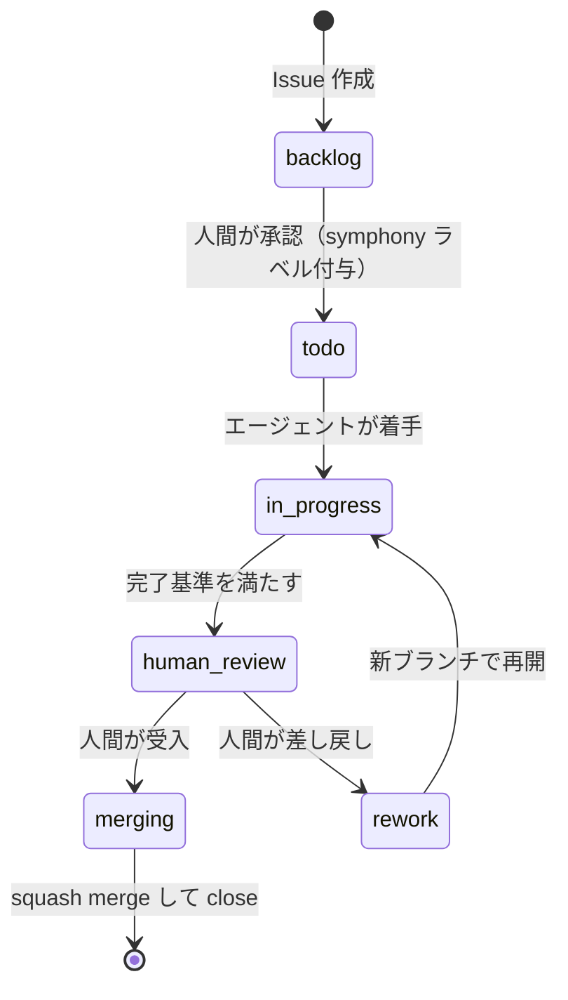

# Issue 駆動開発ガイド（SDD × Symphony）

このガイドは、仕様駆動開発（SDD）の「7 つの工程」を、[openai/symphony](https://github.com/openai/symphony) のような **Issue 駆動の自律エージェント運用** と組み合わせる方法を説明します。

## 考え方：仕様は repo、進捗は Issue

SDD と Symphony はどちらも「唯一の情報源」を持ちますが、対象が違います。

| 観点 | SDD | Symphony |
|------|-----|----------|
| 唯一の情報源 | 仕様 Markdown（`docs/specs/`） | Issue の Workpad コメント |
| 答える問い | **何を・なぜ** 作るか | **どこまで** 進んだか |
| 更新する主体 | 人間（AI は補助） | エージェント |

この 2 つを対立させず、**What / Why は repo の仕様、How / Status は Issue** に置くのがこの運用の骨格です。

- 仕様（工程①〜③）は [`docs/specs/`](../specs/README.md) の Markdown に置き、人間が承認します（原則 P-8）。エージェントは読むだけで、憲章は変更しません。
- タスク（工程④）は **タスク 1 件 = Issue 1 件 = PR 1 件** に対応させます。SDD の「30 分レビュー粒度」は、Symphony の「1 Issue = 1 エージェント実行 = 1 PR」とそのまま重なります。
- 実装・検証（工程⑤⑥）は Issue の Workpad と PR が記録そのものになります。仕様とは別に、手で実装記録を書く必要はなくなります。
- 運用（工程⑦）で見つかったフィードバックは `sdd:backlog` の Issue として投入します。

## 7 つの工程と Issue 状態の対応

GitHub Issues の状態は `open` / `closed` しかないため、工程の進行は `sdd:*` ラベルで表します。**ラベルは常に 1 つだけ**付いている状態を保ちます。

| SDD 工程 | ラベル | 動く主体 | 何が起きるか |
|----------|--------|----------|--------------|
| ①〜③ 原則・仕様・設計（承認待ち） | `sdd:backlog` | 人間 | 仕様をレビューし、受入条件を書く。エージェントは一切触らない |
| ④ タスク化済み・着手可 | `sdd:todo` + `symphony` | 人間が付与、エージェントが拾う | ポーリングで検知され、作業ディレクトリが作られる |
| ⑤ 実装 | `sdd:in-progress` | エージェント | Workpad に計画・受入条件・検証を書き、実装し、PR を作る |
| ⑥ 検証・受入 | `sdd:human-review` | 人間 | PR と仕様差分をレビューする。エージェントは何も変更しない |
| ⑥ 受入完了 | `sdd:merging` | エージェント | 競合解消、CI green 確認、squash merge、Issue close |
| ⑦ 移行・運用 | `closed` | 人間 | フィードバックは新しい `sdd:backlog` Issue に |
| 差し戻し | `sdd:rework` | エージェント | 既存 PR と Workpad を破棄し、新ブランチでやり直す |



## 防波堤：`symphony` ラベル

`WORKFLOW.md` の `required_labels: [symphony]` により、`symphony` ラベルが無い Issue はエージェントの対象になりません。仕様承認前の Issue に実装が走る事故は、このラベルを人間だけが付ける運用で防ぎます。

`sdd:todo` と `symphony` は必ずセットで付けてください。片方だけでは動きません。

## エージェントの行動規範：`ethics/`

エージェントが従う規範は、[ethics/](../../ethics/README.md) に条文として置きます。**`ethics/` に条文を追記すれば、エージェントはその規範に従って動くようになります。** `WORKFLOW.md` に規則を書き足す必要はありません。

規範は効力の強さで 4 層に分かれます。上位の層が下位の層を支配し、下位の条文は必ず上位の条文を根拠に持ちます。

| 層 | 答える問い | 改正できる人 | エージェントによる変更 |
|----|-----------|--------------|------------------------|
| 理念 | 何のためか | 最高責任者 | 不可 |
| 原則 | どう判断するか | 人間（レビュー必須） | 不可 |
| 規則 | 何をする・しないか | 人間（PR レビュー） | 不可 |
| 慣習 | 普段どうするか | チームの裁量 | 可 |

規範がエージェントに届く経路は 3 つあります。

| 経路 | 仕組み | 対象 |
|------|--------|------|
| プロンプトへの注入 | `python3 -m ethics sync` が、条文集を `WORKFLOW.md` と `AGENTS.md` の `<!-- ethics:begin -->` 〜 `<!-- ethics:end -->` に書き込む | 全条文 |
| PR の自動検査 | [ethics-pr-guard](../../.github/workflows/ethics-pr-guard.yml) が、`適用点: pr` かつ `検査: deterministic` の規則を PR ごとに実行する | 決定的に検査できる規則 |
| 人間のレビュー | `sdd:human-review` で、自動では検査できない条文を確認する | `検査: judge` の条文 |

### 規範を追加する手順

1. 該当する層のファイルに条文を追記する（書式は [ethics/README.md](../../ethics/README.md)）。`根拠` に上位層の条文 ID を書く
2. 機械的に検査できる規則なら、`ethics/guards/` にガードを書き、条文に `適用点: pr` と `検査: deterministic guards/<ファイル>.py` を指定する
3. 構造を検査し、プロンプトへ反映する

   ```bash
   python3 -m ethics lint ethics --strict --tree
   python3 -m ethics sync
   ```

4. 条文と、`WORKFLOW.md`・`AGENTS.md` の差分を同じ PR に含める。CI は、根拠の欠落などの構造の誤りと、反映漏れを検出する

### エージェントが規範を書き換えられない仕組み

エージェントの PR（`symphony` ラベル、または `symphony/` で始まるブランチ）が、`ethics/`（慣習を除く条文、ガード、執行の仕組み）、プロジェクト憲章、`WORKFLOW.md`、`AGENTS.md`、`CLAUDE.md`、CI の定義を変更すると、規則 R-5 により CI が失敗します。CI は **base ブランチ側の条文とガード**で検査するため、PR の中でガードを書き換えても検査を逃れられません。

規範の見直しが必要だとエージェントが判断した場合は、`sdd:backlog` の Issue として起票させ、人間が改正します。

## 人間とエージェントの責任分界

### 人間がやること

1. 仕様（工程②）と設計（工程③）を Markdown に書き、レビューして承認する
2. タスク分割（工程④）として Issue を切る。[SDD タスク テンプレート](../../.github/ISSUE_TEMPLATE/sdd-task.yml) を使い、**関連する仕様・受入条件・Validation** を埋める
3. 下記の昇格基準を満たした Issue に `sdd:todo` と `symphony` を付ける
4. `sdd:human-review` になった PR をレビューする。特に「仕様差分」節を読み、仕様の変更が妥当か判断する
5. 受入なら `sdd:merging`、差し戻しなら `sdd:rework` に変える。差し戻し理由は Issue コメントに書く
6. 運用で見つかった課題を `sdd:backlog` Issue として投入する

### エージェントがやること

1. 行動規範（`WORKFLOW.md` に注入された `ethics/` の条文）に従う。憲章（`spec-ai-writer/docs/CONSTITUTION.md`）と Issue が指す仕様を読む
2. `## SDD Workpad` コメントを 1 つ作り、計画・受入条件・検証をそこに書き続ける
3. 仕様に書かれたことだけを実装する。仕様に無い改善は `sdd:backlog` Issue として起票する
4. 仕様との乖離を見つけたら、同じ PR で仕様も更新し、PR の「仕様差分」に理由を書く
5. 受入条件と Validation を全件満たし、PR フィードバックを一掃し、CI を green にしてから `sdd:human-review` に変える
6. `sdd:merging` になったら land 手順でマージし、Issue を close する

詳細な手順は [WORKFLOW.md](../../WORKFLOW.md) のプロンプト本文に書かれています。

## `sdd:todo` に昇格する基準

以下をすべて満たしたときだけ、`sdd:todo` と `symphony` を付けてください。

- [ ] 関連する仕様がレビュー済みで承認されている
- [ ] 受入条件が検証可能な形（コマンド、画面、期待値）で書かれている
- [ ] Validation に実行手順が書かれている
- [ ] 依存 Issue がすべて close されている、または依存がない
- [ ] 1 PR で完結する粒度になっている（30 分でレビューできるか）

粒度が大きい場合は Issue を分割し、`blocked by #N` で依存関係を書いてください。

## PR の契約

PR 本文は [pull_request_template.md](../../.github/pull_request_template.md) に従います。[pr-spec-link-lint](../../.github/workflows/pr-spec-link-lint.yml) ワークフローが以下を自動検査し、満たさない PR は fail になります。

| 検査 | 理由 |
|------|------|
| `## 関連する仕様` に repo 内 Markdown への相対リンクがある | 仕様に紐づかない変更を防ぐ（原則②「唯一の情報源」） |
| `## 仕様差分` が空でない | 仕様を変えたか変えていないかを必ず明示する（原則③「変更と反復が前提」） |
| `Fixes #N` がある | Issue と PR を 1 対 1 で結び、マージで Issue が close される |

ローカルで確認する場合:

```bash
python3 .github/scripts/check_pr_body.py path/to/pr_body.md
```

この契約は、行動規範の規則 R-4 としても登録されています。[ethics-pr-guard](../../.github/workflows/ethics-pr-guard.yml) は同じ検査を、他の規則（R-5 など）とまとめて実行します。規則をまとめて確認する場合:

```bash
git diff --name-only origin/main...HEAD > /tmp/files.txt
python3 -m ethics check-pr ethics --files-from /tmp/files.txt --body-file path/to/pr_body.md --labels symphony
```

## 仕様の置き場所：`docs/specs/`

仕様は `docs/specs/` に記述します（原則 P-8）。従来は 1 つのファイルに工程②〜⑥をまとめて書いていましたが、Issue 駆動では、工程⑤⑥は Issue の Workpad と PR に自動で残るため、repo に残すのは **工程②③（仕様・設計）だけ** になります。

| 項目 | 従来 | Issue 駆動 |
|------|------|-----------|
| 置き場所 | プロジェクトごとの任意の場所 | `docs/specs/` |
| 設計計画のファイル名 | `<日付>-<件名>.md` | `<Issue番号>-<件名>.md` |
| 書く工程 | ②〜⑥ | ②③（設計判断がある場合のみ） |
| ⑤ 実装記録 | ファイルに手書き | Issue の Workpad |
| ⑥ 検証記録 | ファイルに手書き | Workpad の Validation と PR の仕様差分 |

小さな変更で設計判断が無い場合は、Issue テンプレートの「設計メモ」欄で十分です。ファイルは作らなくて構いません。

## Symphony のセットアップ

1. [openai/symphony](https://github.com/openai/symphony) の手順でランナーを用意する（Elixir 参照実装、または `SPEC.md` 準拠の自作）
2. repo をフォークした場合は `WORKFLOW.md` の `tracker.provider.repo` を自分の `owner/repo` に書き換える
3. 環境変数を設定する

   | 変数 | 用途 |
   |------|------|
   | `GITHUB_TOKEN` | Issue の読み取り、ラベル変更、コメント編集、PR 作成に使う。`repo` スコープが必要 |
   | `SDD_REPO_URL` | 作業ディレクトリに clone する URL（`git@github.com:owner/repo.git` など） |

4. リポジトリに以下のラベルを作成する

   ```bash
   gh label create symphony --color 7057ff --description "エージェントの対象"
   gh label create sdd:backlog --color ededed --description "仕様承認前"
   gh label create sdd:todo --color 0e8a16 --description "承認済み・着手可"
   gh label create sdd:in-progress --color fbca04 --description "実装中"
   gh label create sdd:human-review --color d93f0b --description "人間の受入待ち"
   gh label create sdd:merging --color 1d76db --description "受入完了・マージ中"
   gh label create sdd:rework --color b60205 --description "差し戻し"
   ```

5. `WORKFLOW.md` のあるディレクトリで Symphony を起動する

## 注意点

- Symphony の参照実装は Codex（`codex app-server`）を前提にしています。他のコーディングエージェントで回す場合は `codex.command` を差し替えるか、`SPEC.md` 準拠の別ランナーが必要です。`WORKFLOW.md` とテンプレートは repo 側の契約なので、ランナーを後から選べます
- `GITHUB_TOKEN` はエージェント子プロセスには渡されず、Symphony がホスト側で `github_api` ツールを実行します。トークンの権限がそのままエージェントの権限になるため、最小権限で発行してください
- 高信頼環境向けの設定（`approval_policy: never`）になっています。本番コードを扱う場合は [セキュリティとプライバシーガイド](security-privacy-guide.md) を参照し、サンドボックス設定を見直してください

## 関連ドキュメント

- [WORKFLOW.md](../../WORKFLOW.md) - Symphony のワークフロー定義とエージェント向けプロンプト
- [ethics/README.md](../../ethics/README.md) - エージェントの行動規範（倫理階層）の書式と検査
- [タスク分割工程のサンプル](../../archive/examples/04-task-breakdown.md) - 30 分レビュー粒度の考え方
- [スクリプト集](../../archive/docs/tools/scripts.md) - CI/CD の他の設定例
- [プロンプト集](../../archive/docs/tools/prompts.md) - PR / Issue 説明文の生成プロンプト
